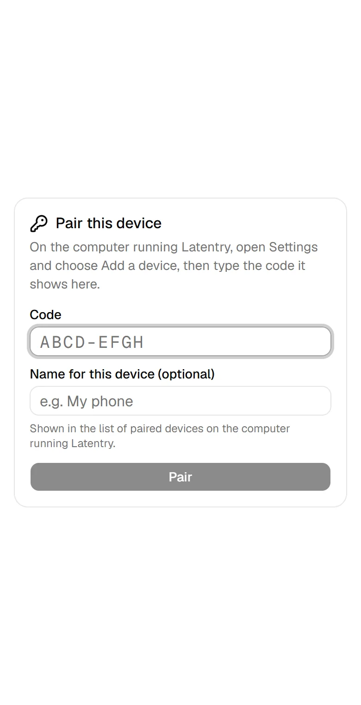
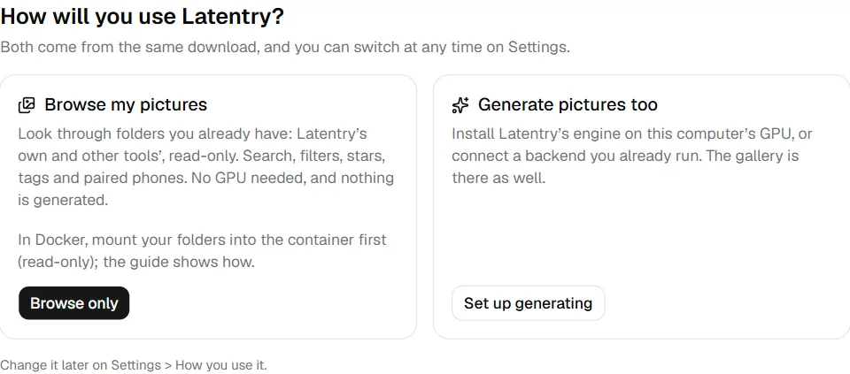

# Getting started

Latentry runs in Docker, with its settings, pictures, engine and models in
one data volume. To install it without Docker, see
[Without Docker](install/native.md).

There are two ways to use it, from the same download:

- **[Browse your pictures](#browse-your-pictures)**: look through the
  folders you already have, Latentry's and other tools', read-only. No GPU
  is needed. This is [gallery-only mode](guide/gallery-only.md).
- **[Generate too](#generate-too)**: install Latentry's engine on your
  NVIDIA GPU, or connect a backend you already run. The gallery comes with
  it.

The first page asks which one, and you can switch at any time on
**Settings > How you use it**. Starting and pairing are the same for both.

## What you need

- **Docker**: [Docker Desktop](https://www.docker.com/products/docker-desktop/)
  on Windows, or Docker Engine with the Compose plugin on Linux.

Only for generating:

- For the built-in engine, an **NVIDIA GPU**:
    - Windows: Docker Desktop with the WSL 2 backend, and a current NVIDIA
      driver.
    - Linux: the
      [NVIDIA Container Toolkit](https://docs.nvidia.com/datacenter/cloud-native/container-toolkit/latest/install-guide.html).
    - About 4 GB of disk for the engine, plus 5–7 GB per model.
- Or a backend you already run: a server speaking the
  [backend API](backend-api.md), or AUTOMATIC1111 / Forge started with
  `--api`.

On a Mac, a container cannot use the GPU, so the engine would run on the
CPU only. Install Latentry [without Docker](install/native.md) there.

[Support](reference/support.md) lists the systems, GPUs and browsers that
are checked.

## Start it

```bash
git clone https://github.com/33rd-kk/latentry.git
cd latentry
docker compose -f compose.yaml -f compose.gpu.yaml up -d   # with an NVIDIA GPU
docker compose up -d                                       # without
```

To browse folders you already have, add them to `compose.yaml` first,
read-only (`:ro`); see
[Your own picture folders](install/docker.md#your-own-picture-folders).

The first start downloads Latentry's official image, which takes a few
minutes ([how to check it](install/docker.md#the-image)). Latentry then
listens on **<http://localhost:3000>**, on this computer only.

## Make this browser the owner

In Docker, your browser is not "this computer" to Latentry, so it has to
pair like any other device. The first one pairs with an **owner code**,
which only a terminal on this computer can make:

```bash
docker compose exec latentry npm run owner-code
```

It prints a code, once. Open **<http://localhost:3000>**: it shows **Pair
this device**. Type the code there and choose **Pair**.

{ width="260" }

The code works once, for 10 minutes. This browser is now an **owner
device** for 7 days: it may change Settings and Setup and pair your other
devices. When it ends, run the command again. See
[Owner device](guide/owner-device.md).

## Browse your pictures

On the first page, under **How will you use Latentry?**, choose **Browse
only**.



Latentry turns on [gallery-only mode](guide/gallery-only.md) and opens
**Settings > Gallery folders**. Choose **Add folder**, give the path
inside the container (for example `/pictures/comfyui`) and a
display name, and save. Open **Gallery**: the folder is there, with every
picture's settings read from the file.

For tags under each picture, download the WD14 tagger on **Setup**. It runs
inside Latentry, without a GPU. Generating, the engine and backends stay
off, and so do their parts of Latentry's API; see
[what you can do](guide/gallery-only.md#what-you-can-do).

## Generate too

On the first page, choose **Set up generating**. It shows how to install
the engine or add a server you already run.

### Set up the engine

Open **Setup**. It runs in three steps:

1. **Install the engine.** Latentry looks at your GPU and installs Python
   3.12, the matching PyTorch build and stock diffusers into the data
   volume (about 3–4 GB, a few minutes). The packages are the ones pinned
   for your machine, each file checked against its hash.
2. **Download a model.** Each model comes from its publisher on Hugging Face.
   Read its licence (linked on the page; some are non-commercial), tick the
   box, and download.
3. **Download a tagger** (optional), for reading tags from pictures.

See [Setup and the engine](guide/engine.md) for what each part shows.

Prefer servers you already run? Add them on the [Settings](guide/settings.md)
page instead. A server on this computer is
`http://host.docker.internal:<port>` from inside the container; see
[Backends on this computer](install/docker.md#backends-on-this-computer).

### Generate the first picture

1. Open **Generate**. Pick the backend (`engine` for the built-in one) and
   the model.
2. Write a positive prompt, for example `1girl, solo, smile, upper body,
   cherry blossoms`.
3. Press **Generate**. Progress shows per step; the pictures appear on the
   right and are saved to the gallery, in the data volume.

## Next

- [The gallery](guide/gallery.md): search, stars, tags, stacks and Compare.
- [Generate](guide/generate.md) for everything on that page, then
  [From a picture](guide/from-a-picture.md),
  [Bigger pictures](guide/bigger.md) and [Many pictures](guide/many.md).
- [Docker](install/docker.md): updating, where the data is, your own
  picture folders, and using Latentry from a phone.
