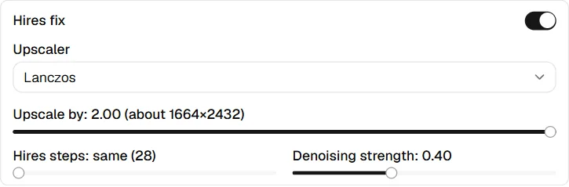
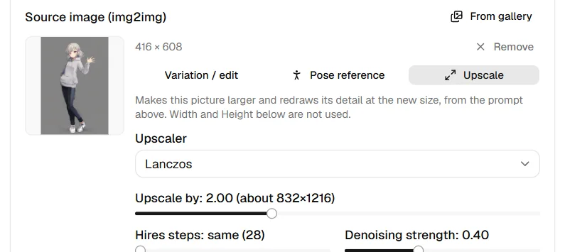

# Bigger pictures

Two ways to get a larger picture with real detail instead of a stretched
one: hires fix for a new picture, Upscale for one already in the gallery.

## Hires fix

{ width="360" }

**Hires fix** draws each picture at the size above, upscales it, and redraws
it at the larger size, so the detail is drawn at full resolution instead of
stretched. It is off until you switch it on, and takes longer: the progress
bar counts both passes.

- **Upscaler**: how the picture is enlarged before it is redrawn. Lanczos
  works everywhere and needs nothing extra. An A1111 or Forge web UI also
  offers its own upscalers (R-ESRGAN and the like) and its latent modes;
  ComfyUI offers the upscale models in its `models/upscale_models` folder,
  listed by file name. Latentry's engine has Lanczos only.
- **Upscale by**: how much larger, with the size it ends at.
- **Hires steps**: the steps of the second pass. At 0 it runs as many as the
  first.
- **Denoising strength**: how much the second pass may change. Around 0.3–0.5
  adds detail and keeps the picture; higher values redraw more.

It applies to pictures drawn from the prompt, with or without a skeleton
pose. With a source image the run is img2img, so the section is hidden, and
a ComfyUI workflow from the folder keeps its own passes. Backends that
cannot do it say so under **Not available on this backend**.

The saved picture records the first pass's size with its hires settings, as
A1111 does. **Generate with these settings** in the gallery turns hires fix
back on with them, on the same backend.

## Upscale a picture

{ width="400" }

To give a finished picture the same treatment, choose **Upscale** in the
gallery's side panel, or set the picture as the source and pick **Upscale**
under **What the source is for**. The picture's own prompts come along when
it has them; otherwise use the ones in the form. The same knobs as hires fix
appear in the source slot: **Upscaler**, **Upscale by** (from the picture's
own size, up to 4096 pixels a side), **Hires steps** (at 0, the form's
Steps) and **Denoising strength**. Width and Height are not used.

- An A1111 or Forge web UI enlarges the picture in its Extras tab with the
  chosen upscaler, then redraws it with img2img. Its latent modes are not
  offered here.
- ComfyUI loads the picture at its own size and enlarges it in the graph.
- Latentry's engine enlarges it with Lanczos and redraws it with SDXL or
  Anima, one picture at a time.
- The saved picture records the size it had before, its hires settings and
  the mode `upscale`.
- A picture larger than 2048 pixels a side is shrunk to that when it is
  loaded as a source.

