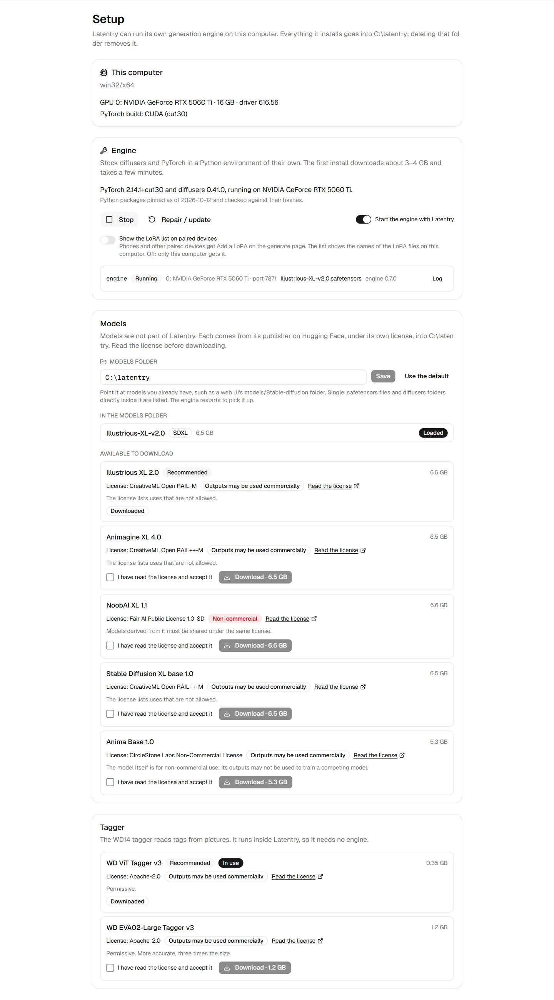

# Setup and the engine

Latentry can run its own generation engine: stock diffusers and PyTorch in a
Python environment of their own. The **Setup** page installs and runs it.
Setup can only be changed from the computer Latentry runs on.

## This computer

The GPUs found (name, memory, driver) and the PyTorch build that will be
installed for them: CUDA 13.0, 12.8 or 12.6 by driver, Apple Metal, or CPU.
Without an NVIDIA GPU the engine runs on the CPU, which takes minutes per
picture.

## Engine

- **Install the engine**: gets uv, Python 3.12, PyTorch (the large part),
  diffusers and the engine, then checks the GPU from Python. About 3–4 GB,
  a few minutes. Everything goes into `.runtime/`, Python included: the
  engine does not use a Python or uv you installed yourself, and ignores your
  own uv settings (`UV_*` variables, `uv.toml`). Deleting `.runtime/` removes
  the engine. An engine installed before this used a Python 3.12 from this
  computer when it found one; **Repair / update** moves it onto its own.
  uv is a fixed release, checked against its published SHA-256 before it is
  run.
- **Repair / update**: run it after updating Latentry, or when the engine
  will not start.
- **Start** / **Stop**, and **Start the engine with Latentry**. One engine
  runs per NVIDIA GPU, each with its port, state, loaded model, version and
  **Log**. An engine still running a version other than the one in
  Latentry's folder was started before an update; Setup says so, and a stop
  and start runs the new one.
- **Show the LoRA list on paired devices** (off by default): phones and
  other paired devices get **Add a LoRA** on the Generate page too. The list
  shows the names of the LoRA files on this computer.

The engine decides once at start how to use the GPU, from the memory that
is free then:

| Free VRAM | Batch | Offload |
|---|---|---|
| 11.5 GB and up | 2–8 images at once | none |
| 7–11.5 GB | 1 | model offload to RAM |
| below 7 GB | 1 | sequential offload |

When it runs out of memory, it halves the batch and tries again.

With [hires fix](generate.md#hires-fix) on, the engine draws one picture at
a time: the first pass, then the second at the larger size, before the
next. It upscales with Lanczos only, so no upscale model is fetched or
loaded. The second pass encodes and decodes the larger picture tile by
tile, so it fits beside the model (and the pose ControlNet) on a 16 GB GPU.
On Anima, hires fix and a skeleton pose do not go together yet; an SDXL
model takes both. [Upscale](generate.md#upscale-a-picture) works the same
way on a source picture: Lanczos to the larger size, then one tiled redraw.

## Models

Models are not part of Latentry. Each comes from its publisher on Hugging
Face, under its own licence, into the **models folder**:

- **In the models folder**: what is there now; **Load** one, or see which is
  loaded. Single `.safetensors` files and diffusers folders are listed.
  The engine reads weights only from `.safetensors` files, which cannot run
  code. A diffusers folder with a part whose weights are only in a pickle
  format (`.bin`, `.ckpt`, `.pt`) is refused when you load it, and the
  message names that part. A single-file SDXL checkpoint needs SDXL's
  config files (scheduler, text encoders, tokenizers, no weights); the
  engine fetches them once from a fixed commit, checks each against its
  SHA-256 and keeps them in the controls folder, so later loads need no
  network.
- **Available to download**: the licence, whether outputs may be used
  commercially, and a box to accept the licence before **Download**. Each
  download is a fixed version of the repository, and its files are checked
  against their SHA-256 before they are kept, so a repository that changes
  later cannot change what you get.
- **Models folder**: point it at models you already have, such as a web UI's
  `models/Stable-diffusion` folder.

The engine runs SDXL-family checkpoints (SDXL, Illustrious, NoobAI,
Animagine, Pony…) with txt2img, img2img, inpainting and pose, and Anima with
txt2img, img2img and pose (v1.0 models). The pose models download on first
use into `models/controls/`; Anima-Control-Pose is non-commercial, as Anima
itself is.

## Tagger

The WD14 tagger reads tags from pictures. It runs inside Latentry, on the
CPU, so it needs no engine. Download one here and **Use this one**.
