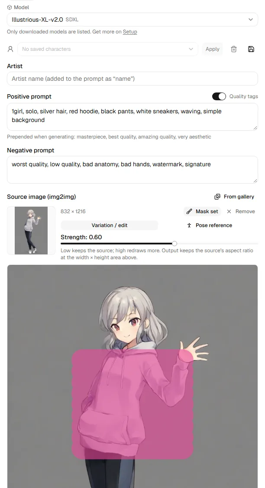
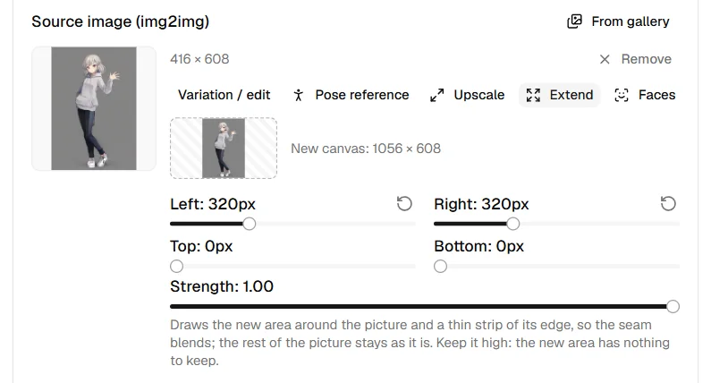

# From a picture

Start from a picture you already have: redraw it, change only part of it,
grow its canvas, or take its tags. The rest of the form works as on
[Generate](generate.md).

Drop a picture on **Source image (img2img)**, choose one **From gallery**, or
use **Use as source** under a result. Then choose what it is for:

- **Variation / edit**: the picture is redrawn. **Strength** decides how much:
  low keeps the source, high redraws more. The output keeps the source's
  aspect ratio at about the width × height area set below.
- **Pose reference**: the reference's composition and silhouette carry over,
  the rest is redrawn (strength starts at 0.85). For exact limbs, use the
  [skeleton pose](pose.md) instead.
- **Upscale**: the picture itself is made larger; see
  [Upscale a picture](bigger.md#upscale-a-picture).
- **Extend**: the canvas grows around the picture and the new area is drawn
  (outpainting); see [Extend a picture](#extend-a-picture-outpainting).
- **Faces**: each face in the picture is redrawn larger and pasted back; see
  [Fix faces](#fix-faces).

While a source is set, the **Hires fix** section is hidden.

## Inpainting: redraw only part of it

{ width="420" }

Press **Draw mask** and paint over what should change: only the painted area
is redrawn, everything else stays exactly as the source. **Brush**,
**Eraser**, **Clear** and the brush size are under the picture. Strength
around 0.6–0.8 works best; near 1.0 the painted area ignores the source and
stops fitting its surroundings.

The source picture, mask and pose are sent together, up to 48 MB. Only a
very detailed 2048px source comes near that; if it goes over, a message asks
for a smaller or simpler picture.

On a ComfyUI backend, the source and mask are uploaded into ComfyUI's input
folder under two names that each run reuses; after a secret run they are
overwritten with an empty picture (see
[Backends](../reference/backends.md#comfyui)).

## Extend a picture (outpainting)

{ width="420" }

**Extend** (on backends that can inpaint) grows the canvas: **Left**,
**Right**, **Top** and **Bottom** set how many pixels each side gains, and
the preview shows the new canvas with the picture in place. Only the new
area and a thin strip of the picture's edge (32 pixels, so the seam blends)
are drawn; the rest of the picture stays as it is. The prompt should
describe the whole new scene. Strength starts at 1.0, since the new area
has nothing to keep.

The canvas can be at most 2048 pixels a side, and each side grows by at
most 1024; a slider stops where the canvas would pass that. The size is
rounded up to a multiple of 16 on the right and bottom, so every backend
draws it as it is. The width × height set below do not apply. The picture
is saved with the mode `outpaint`.

## Fix faces

**Faces** (on backends that can inpaint) finds the faces in the picture and
redraws each one: it cuts a square around the face, sends it to the backend
as an ordinary inpaint at about the width × height area set below, and
pastes the redrawn face back through a soft-edged mask. A face that is small
in the picture gets the backend's full resolution, the way ADetailer works
in a web UI. Nothing outside the faces changes, and it works the same on
every backend that inpaints.

- **Find faces in**: **Anime / illustration** or **Photos**. Each uses a
  face detector that runs on this computer; download it first under **Face
  detectors** on [Setup](engine.md). Nothing is downloaded until you press
  **Download**, and the picture is never sent anywhere to be looked at.
- **Denoise**: how much of each face is redrawn (0.4 to start). Higher
  changes the face more.
- **Faces at most**: the surest faces first, up to 8.
- **Confidence**: how sure the detector must be. Lower finds more faces,
  and more things that are not faces.
- **Face prompt**: what each face is drawn from; empty uses the prompt
  above. The negative prompt, sampler, steps, CFG and LoRAs are the form's.

The faces are drawn one after another as one run, with one progress bar for
all of them, on the seed set below (the next face on the next seed). If no
face is found, the run is refused before it starts: try the other detector,
or a lower confidence. A run with Faces cannot be part of an [X/Y
grid](many.md#xy-grid). The picture keeps its size and is saved with the
mode `facefix`, its denoise as the strength.

| Detector | For | Size | License |
|---|---|---|---|
| YuNet (OpenCV Zoo) | Photos and realistic pictures | 0.2 MB | MIT |
| Anime face detection v1.4 (deepghs) | Anime and illustrations | 12 MB | MIT on its model card; trained with Ultralytics YOLOv8, whose AGPL-3.0 Ultralytics says also covers trained models |

Both are fetched from a fixed commit and kept only if their SHA-256
matches. Latentry runs them with its own code (onnxruntime), and ships
neither.

## Tags from the source

**Extract tags** reads the source's WD14 tags (a tagger must be set up; see
[Settings](settings.md)) and sorts them into groups: character, subject,
hair, eyes, body, outfit, expression, pose, scene / other. The groups that
make the character (hair, eyes, body, outfit) start selected; click
a tag or a group name to toggle, then **Add to prompt**. For a pose
reference, only the pose group starts selected, so the reference's hair or
outfit does not carry over.

