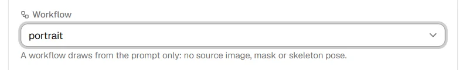
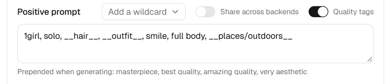
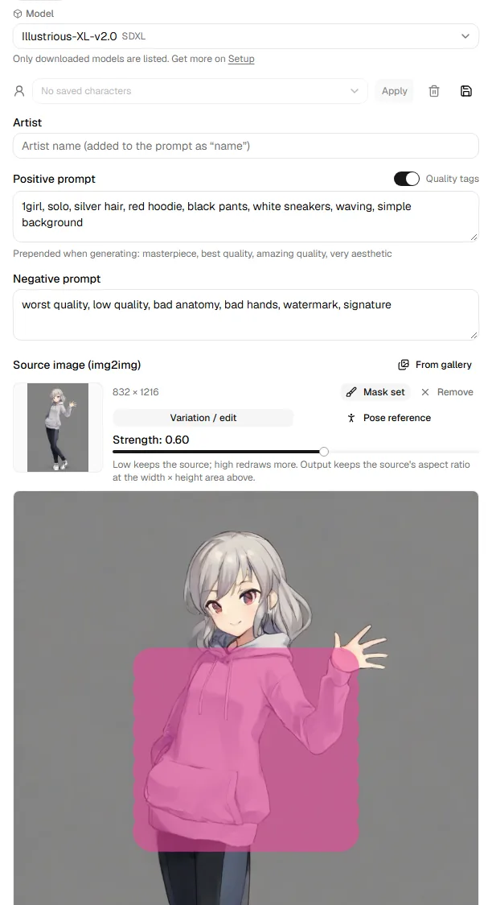
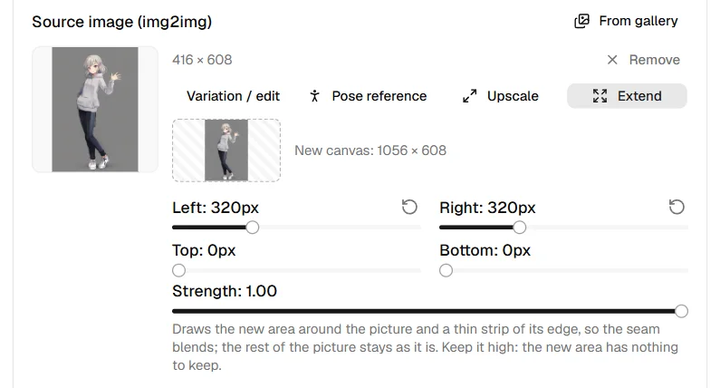

# Generate

The form on the left, the results on the right. Each backend keeps its own
form, so switching backends and back keeps what you typed.

## Backend, profile and model

- **Backend**: where the picture is made. A dot shows whether it is ready,
  busy or offline.
- **Model profile**: the model family the form is set up for (Anima, SDXL,
  Illustrious / NoobAI, Pony, generic). It fills sizes, steps, CFG, negative
  prompt, quality tags and how an artist is written. Change it any time;
  defaults per profile are set on [Settings](settings.md).
- **Model** (built-in engine): which downloaded model the engine has loaded.
  Picking another loads it; get more on [Setup](engine.md).
- **Workflow** (a ComfyUI backend with a workflows folder): the built-in
  graph, or one of your own workflows. Under it, the page says what the
  workflow lacks (left as in the file). A workflow draws from the prompt
  only, so the source image is hidden while one is chosen. See
  [Backends](../reference/backends.md#your-own-workflows).

{ width="420" }

## Show only what you use

The **Show** row under the backend hides the parts of the form you do not
need: **Characters**, **Source image**, **Pose**, **Hires fix** and
**X/Y grid** (only those the backend can do are listed). A hidden part is
not used: a source image, a skeleton, hires fix or a grid in it is not sent.
What it holds is kept, and an amber dot on its button says so, until you
show it again. Sending a picture to the form as a source (from the gallery
or a result) shows **Source image** again.

Which parts are hidden is remembered in this browser only, and not while
[secret mode](#secret-mode) is on.

## Prompts

- **Artist**: a name, added to the prompt the way the profile writes it
  (for example `@name` or `by name`).
- **Positive prompt** and **Negative prompt**.
- **Share across backends**: by default each backend's form remembers its own
  prompt. Turn this on and every backend shows the same prompt and artist,
  so switching backends keeps your words and only the settings change. Turn
  it off to get each backend's own prompt back. The negative prompt is always
  per backend, because what to avoid depends on the model.
- **Quality tags**: when on, the profile's quality tags (shown under the
  prompt) are put in front when generating.
- **Tag spelling**: write tags either way, `long_hair` or `long hair`. When
  you generate, both prompts are sent in the spelling the profile's model
  family was trained on. A prompt or tags sent from the gallery arrive in that
  spelling too. Score tags, face tags such as `^_^`, LoRA calls, `BREAK` and
  sentences and wildcards are left as written. Change this per profile on
  [Settings](settings.md).
- **LoRAs**: call one in the prompt as `<lora:name:0.8>`. An A1111 web UI,
  ComfyUI (which loads the file of that name from its LoRA list) and
  Latentry's engine apply it. For the engine, put the LoRA files in the
  `loras` folder inside the models folder; **Add a LoRA** next to the prompt
  lists them and puts the call in for you (a LoRA made for another model
  family is greyed out). **Add a LoRA** is on this computer only, unless
  **Show the LoRA list on paired devices** is on (Setup > Engine): the list
  is the names of your LoRA files. The engine refuses a run that calls a LoRA it does
  not have, instead of running without it. Other backends read the tag as
  plain words, and the prompt shows a note saying so.
- **Wildcards**: write `__name__` in the prompt (or the negative prompt),
  and each run takes one line of `name.txt` from the wildcards folder set
  on [Settings](settings.md#wildcards); `__folder/name__` reads from a
  subfolder, as in A1111's Dynamic Prompts extension. **Add a wildcard** next
  to the prompt lists them and puts one in at the cursor. A line is picked
  once per run, so all the pictures of a run share it. With a fixed seed the
  same lines come back, so a run can be drawn again; with -1 each run picks
  anew. A line may hold wildcards of its own, up to 3 levels. The lines are
  respelled for the profile like the rest of the prompt. A wildcard with no
  file stops the run and says which one. The picture keeps the prompt with
  the lines filled in, and the viewer shows the prompt as typed under
  **Wildcards**. On paired devices wildcards work only if **Use on paired
  devices** is on (Settings > Wildcards).

  { width="560" }

- **Saved characters**: save the tags that make a character, together with
  the artist, negative prompt and seed, and apply them to any form later. In
  [secret mode](secret-mode.md) a new one is only kept until secret mode is
  turned off.

## Source image: img2img and inpainting

Drop a picture on **Source image (img2img)**, choose one **From gallery**, or
use **Use as source** under a result. Then choose what it is for:

- **Variation / edit**: the picture is redrawn. **Strength** decides how much:
  low keeps the source, high redraws more. The output keeps the source's
  aspect ratio at about the width × height area set below.
- **Pose reference**: the reference's composition and silhouette carry over,
  the rest is redrawn (strength starts at 0.85). For exact limbs, use the
  [skeleton pose](pose.md) instead.
- **Upscale**: the picture itself is made larger; see
  [Upscale a picture](#upscale-a-picture).
- **Extend**: the canvas grows around the picture and the new area is drawn
  (outpainting); see [Extend a picture](#extend-a-picture-outpainting).

While a source is set, the **Hires fix** section is hidden.

### Inpainting: redraw only part of it

{ width="420" }

Press **Draw mask** and paint over what should change: only the painted area
is redrawn, everything else stays exactly as the source. **Brush**,
**Eraser**, **Clear** and the brush size are under the picture. Strength
around 0.6–0.8 works best; near 1.0 the painted area ignores the source and
stops fitting its surroundings.

The source picture, mask and pose are sent together, up to 48 MB. Only a
very detailed 2048px source comes near that; if it goes over, a message asks
for a smaller or simpler picture.

On a ComfyUI backend, the source and mask are uploaded into ComfyUI's input
folder under two names that each run reuses; after a secret run they are
overwritten with an empty picture (see
[Backends](../reference/backends.md#comfyui)).

### Extend a picture (outpainting)

{ width="420" }

**Extend** (on backends that can inpaint) grows the canvas: **Left**,
**Right**, **Top** and **Bottom** set how many pixels each side gains, and
the preview shows the new canvas with the picture in place. Only the new
area and a thin strip of the picture's edge (32 pixels, so the seam blends)
are drawn; the rest of the picture stays as it is. The prompt should
describe the whole new scene. Strength starts at 1.0, since the new area
has nothing to keep.

The canvas can be at most 2048 pixels a side, and each side grows by at
most 1024; a slider stops where the canvas would pass that. The size is
rounded up to a multiple of 16 on the right and bottom, so every backend
draws it as it is. The width × height set below do not apply. The picture
is saved with the mode `outpaint`.

### Tags from the source

**Extract tags** reads the source's WD14 tags (a tagger must be set up; see
[Settings](settings.md)) and sorts them into groups: character, subject,
hair, eyes, body, outfit, expression, pose, scene / other. The groups that
make the character (hair, eyes, body, outfit) start selected; click
a tag or a group name to toggle, then **Add to prompt**. For a pose
reference, only the pose group starts selected, so the reference's hair or
outfit does not carry over.

## Size, steps and the rest

- Size buttons (1024×1024, 832×1216…) and the **Width** / **Height** sliders;
  the arrows swap them. Some profiles want multiples of 16.
- **Seed**: -1 for random (the button sets it); a fixed seed repeats a
  picture. With several images, each takes the next seed.
- **Steps**, **Image count** (1 to 16 pictures in one run), **Sampler**,
  **Scheduler** and **Guidance scale** (CFG). Backends with speed presets show **Speed preset** instead of
  sampler and steps; **Custom** brings them back.
- A slider moved away from its default shows a small arrow at the end of its
  label: press it to put that one slider back to the profile's value.
- On a phone or tablet, a slider moves only when you drag its knob. A swipe
  that starts on its track scrolls the page, and a tap on the track leaves
  the value alone.
- **Reset** (the arrow next to Generate) puts this backend's form back to the
  profile's defaults.

## Hires fix

{ width="360" }

**Hires fix** draws each picture at the size above, upscales it, and redraws
it at the larger size, so the detail is drawn at full resolution instead of
stretched. It is off until you switch it on, and takes longer: the progress
bar counts both passes.

- **Upscaler**: how the picture is enlarged before it is redrawn. Lanczos
  works everywhere and needs nothing extra. An A1111 or Forge web UI also
  offers its own upscalers (R-ESRGAN and the like) and its latent modes;
  ComfyUI offers the upscale models in its `models/upscale_models` folder,
  listed by file name. Latentry's engine has Lanczos only.
- **Upscale by**: how much larger, with the size it ends at.
- **Hires steps**: the steps of the second pass. At 0 it runs as many as the
  first.
- **Denoising strength**: how much the second pass may change. Around 0.3–0.5
  adds detail and keeps the picture; higher values redraw more.

It applies to pictures drawn from the prompt, with or without a skeleton
pose. With a source image the run is img2img, so the section is hidden, and
a ComfyUI workflow from the folder keeps its own passes. Backends that
cannot do it say so under **Not available on this backend**.

The saved picture records the first pass's size with its hires settings, as
A1111 does. **Generate with these settings** in the gallery turns hires fix
back on with them, on the same backend.

### Upscale a picture

{ width="400" }

To give a finished picture the same treatment, choose **Upscale** in the
gallery's side panel, or set the picture as the source and pick **Upscale**
under **What the source is for**. The picture's own prompts come along when
it has them; otherwise use the ones in the form. The same knobs as hires fix
appear in the source slot: **Upscaler**, **Upscale by** (from the picture's
own size, up to 4096 pixels a side), **Hires steps** (at 0, the form's
Steps) and **Denoising strength**. Width and Height are not used.

- An A1111 or Forge web UI enlarges the picture in its Extras tab with the
  chosen upscaler, then redraws it with img2img. Its latent modes are not
  offered here.
- ComfyUI loads the picture at its own size and enlarges it in the graph.
- Latentry's engine enlarges it with Lanczos and redraws it with SDXL or
  Anima, one picture at a time.
- The saved picture records the size it had before, its hires settings and
  the mode `upscale`.
- A picture larger than 2048 pixels a side is shrunk to that when it is
  loaded as a source.

## Results

Progress shows overall and per image. Each finished picture has:

- **In gallery** (it was saved), **Use as source**, **Download**.
- Click it to view it full screen.

When a new run starts, the pictures on screen move down to **Earlier**,
newest first, so a queue of runs piles up instead of each replacing the
last. Each run folds and unfolds from its heading (hover it for the whole
prompt), and the two most recent start open. The last 5 runs (32 pictures
at most) are kept in this browser tab's memory only: going to the gallery
and back keeps them, and a reload clears them. Every picture is in the
gallery anyway.

In secret mode no prompt is shown in **Waiting** or **Earlier**, even for
runs started before it was turned on, and an open earlier run stays blurred
until **Show these**. A page that has been in secret mode does not keep its
runs for the trip to the gallery and back, even after secret mode is turned
off (see [Secret mode](secret-mode.md#what-it-does)).

Runs live on the server, so reloading the page, or opening it in another
tab, picks up a run in progress. **Cancel** stops it.

### The queue

A backend draws one run at a time. While one is going, **Generate** becomes
**Add to queue**: change the prompt or the settings and add another run, up
to 8 waiting on each backend. They start in turn, each as soon as the one
before it ends, and their pictures are saved like any others.

- **Waiting** under the results lists the runs this page added, with how
  many runs are ahead of the first, and **×** to take one out again.
- Another page or device sees only how many runs are waiting, not what they
  draw, and cannot take them out.
- The list is kept in this browser tab's memory only. Going to the gallery
  and back keeps it. After a reload the runs still start in turn, but the
  page no longer lists them, so they can no longer be taken out. In secret
  mode it is kept only while Generate is open.
- If the backend is busy with a run Latentry did not start (from its own
  web UI, say), the first run says **Waiting for the backend** and starts
  once it is free. After 30 minutes it gives up.
- The queue is held in memory only. Stopping Latentry drops the runs that
  were still waiting.

### X/Y grid

**X/Y grid** under the settings draws the run again for each value of one
setting (the X axis), or of two (X across, Y down), so the pictures can be
compared side by side. Turn it on, pick a setting for each axis and type its
values. The button becomes **Queue grid** with the number of cells.

| Axis | Values |
|---|---|
| CFG, Steps, Seed, Hires denoise | Numbers with commas between them, or a range: `20-40:5` is 20, 25, 30, 35 and 40, and `1-4` steps by 1. Hires denoise needs Hires fix on. |
| Sampler, Scheduler | Click the names the backend lists. |
| Prompt S/R | Text. The first value is looked for in the prompt (or the negative prompt), and each value takes its place in turn: `red hair, blue hair, ""` draws the prompt as typed, then with blue hair, then with neither. Put a value with a comma in it in double quotes. |

To compare a LoRA's weights, use Prompt S/R: with `<lora:style:0.4>` in the
prompt, `<lora:style:0.4>, <lora:style:0.8>, ""` draws it at two weights and
without it.

- Every cell uses the same seed, so the setting is the only thing that
  changes. With the seed on random, one is picked for the whole grid and
  shown above it. Wildcards are filled in once for the whole grid.
- A grid has up to 16 values an axis, 64 cells, and 128 pictures in all
  (cells × pictures per run).
- The grid waits in the queue as **one** run, and its cells run one after
  another with nothing in between. A run added while it goes waits until
  the whole grid is done.
- The cells fill in as they finish. Click one to see it full screen, named
  by its place in the grid, with the values as you typed them. **Cancel
  grid** stops the cell that is going and drops the rest. A backend first
  finishes the step it is on, which on a web UI can take a while: the grid
  says **Stopping…** until it has. The cell that was going says **Stopped**,
  and the ones after it **Did not run**. A web UI hands back the unfinished
  picture it stopped on, which the cell shows marked **Stopped**.
- Each cell's pictures are saved like any others, and record the grid and
  their place in it. In the gallery, **Stack: Same X/Y grid** puts a grid's
  pictures in one card.
- **Save sheet** puts a finished grid's cells in one picture, with the values
  written above and beside them and the settings they change at the top, and
  saves it to the gallery. It uses the first picture of each finished cell,
  from the save folder; a stopped cell is left empty. Nothing is made unless
  you click it, and secret mode does not offer it.
- Another page or device sees only that one run is waiting, not that it is a
  grid or how many cells it has. Like the queue, the grid is kept in this
  tab's memory: after a reload its cells still run and are saved, but the
  page no longer shows the grid.

## Secret mode

The eye at the top right turns on secret mode: what you type is not kept in
the browser, the gallery blurs pictures and hides prompts, and a run is
shown only on the page that started it. Pictures are still saved to the
gallery folder with their prompt. See [Secret mode](secret-mode.md).
