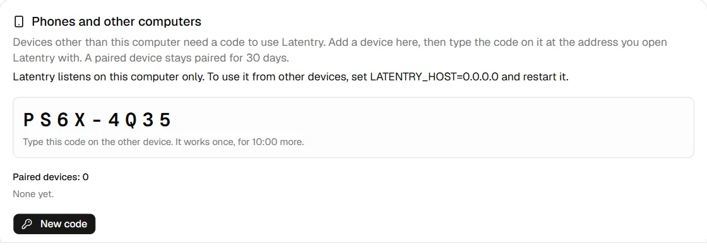
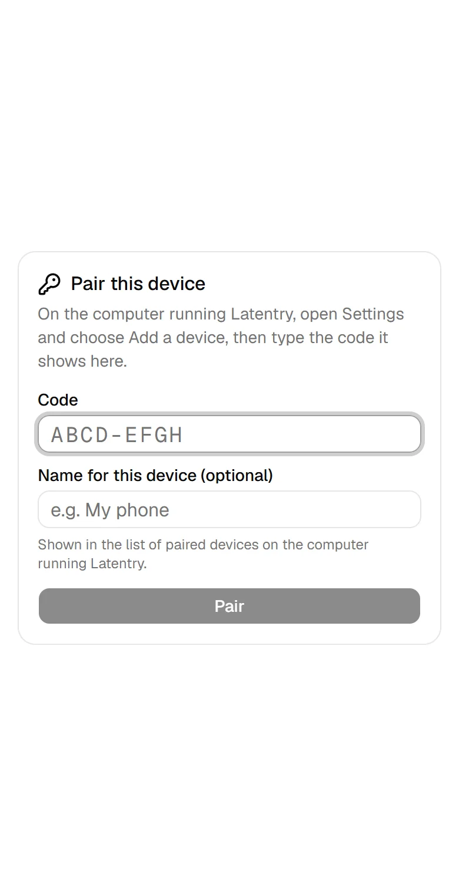

# Other devices and security

Latentry is meant for your own computer or a home network you trust. It has
no accounts or passwords. This computer can always use it; any other device
must be **paired** first, with a code shown on this computer.

## Use it from a phone or another computer

By default Latentry listens on this computer only (127.0.0.1). To open it to
your network:

1. Add to `.env.local` (in the Latentry folder):

    ```bash
    LATENTRY_HOST=0.0.0.0
    ```

2. Restart Latentry (`npm start`). Not `npm run dev`: the development
   server's error pages show this computer's file paths and source code to
   every device that opens them, and it warns when started that way.
3. On Windows, when the firewall asks, allow Node.js on **private** networks.
4. On the other device, open `http://<this computer's address>:3000`, for
   example `http://192.168.1.20:3000`. It shows **Pair this device**.
5. On this computer, open **Settings**, scroll to **Phones and other
   computers** and choose **Add a device**.
6. Type the code it shows on the other device, give the device a name if
   you like (for example "My phone"), and choose **Pair**.



{ width="260" }

The code works once, for 10 minutes. A paired device stays paired for 30
days; then it asks for a new code.

- **On this computer**, the same card lists the paired devices, each with
  its name (or a number), when it was paired and when that ends. **Remove**
  unpairs one device; **Forget all devices** unpairs them all (for a lost
  phone, say).
- **On a paired device**, its **Settings** page says what it is paired as
  and when that ends, and **Unpair this device** unpairs it. From three days
  before the end, every page says so, with a link to pair it again.

The list keeps only the name, when the device was paired and when that
ends; nothing about when or how it is used. It is stored encrypted next to
the settings file.

Paired devices can generate and use the gallery. **Settings and Setup stay
read-only from them**: settings decide which folders are read and written.
To allow changing them from the network as well, set `SETTINGS_EDIT=lan`
(only on a network you trust: anyone who can change settings can point a
backend at their own server and receive your prompts and pictures from then
on); `SETTINGS_EDIT=off` makes them read-only everywhere.

## Backends on other computers

Pairing protects Latentry, not the servers it draws with. A ComfyUI or
AUTOMATIC1111 / Forge server that Latentry reaches at another computer's
address listens on the network itself, and anyone who can reach it can use
it without Latentry: ComfyUI has no login, and its custom nodes run code on
that computer. Exposed ComfyUI servers have been taken over this way.

So **Settings** warns, under the backend, when a `comfyui` or `a1111`
backend's address is not this computer's and it has no token. The safest
setup is the backend on the same computer as Latentry, listening on
127.0.0.1 (ComfyUI's default; an A1111 web UI without `--listen`). For one
on another computer:

- **AUTOMATIC1111 / Forge**: start it with `--api-auth user:password` and
  enter `user:password` as the backend's token.
- **ComfyUI**: put a reverse proxy that asks for a login in front of it,
  bind ComfyUI itself to 127.0.0.1 on that computer, and enter the proxy's
  token (sent as a Bearer token).

Either way, allow only the computer running Latentry through that
computer's firewall if you can. See [Backends](../reference/backends.md).

## Tip: keep the pairing key in your keychain

Paired devices are recognised by a key in `latentry.pairing-key`, next to
the settings file (the Latentry folder by default). The list of devices is
encrypted with it. Anyone who can read that folder can read the key, so you
may prefer to keep it in your system's keychain and hand it to Latentry
when it starts, in `LATENTRY_PAIRING_KEY`. Latentry then reads no key file
and writes none.

Stop Latentry first, run the steps in the Latentry folder, and from then on
start it as shown. Moving the key this way keeps every device paired.

### Windows (PowerShell 7)

The key is sealed for your Windows account with DPAPI, the protection
Credential Manager uses:

```powershell
Get-Content latentry.pairing-key | ConvertTo-SecureString -AsPlainText -Force |
  ConvertFrom-SecureString | Set-Content "$env:LOCALAPPDATA\latentry-pairing-key.dpapi"
Remove-Item latentry.pairing-key

# Each time you start Latentry:
$env:LATENTRY_PAIRING_KEY = Get-Content "$env:LOCALAPPDATA\latentry-pairing-key.dpapi" |
  ConvertTo-SecureString | ConvertFrom-SecureString -AsPlainText
npm start
```

### macOS (Keychain)

```bash
security add-generic-password -a latentry -s latentry-pairing-key -w "$(cat latentry.pairing-key)"
rm latentry.pairing-key

# Each time you start Latentry:
LATENTRY_PAIRING_KEY="$(security find-generic-password -a latentry -s latentry-pairing-key -w)" npm start
```

### Linux (Secret Service: GNOME Keyring, KWallet)

```bash
secret-tool store --label="Latentry pairing key" service latentry account pairing-key < latentry.pairing-key
rm latentry.pairing-key

# Each time you start Latentry:
LATENTRY_PAIRING_KEY="$(secret-tool lookup service latentry account pairing-key)" npm start
```

Good to know:

- Do not put `LATENTRY_PAIRING_KEY` in `.env.local`: that is a file on disk
  again.
- If Latentry starts without it (and without the file), it makes a new key,
  and every device has to pair again.
- While Latentry runs, the key is in its environment, which other programs
  running as you can read. The keychain keeps it off the disk, not away
  from your own account.
- **Forget all devices** empties the list but keeps this key. To replace the
  key as well, store a new one in the keychain (64 hex characters, for
  example from `node -e "console.log(require('crypto').randomBytes(32).toString('hex'))"`);
  every device then pairs again.
- The built-in engine is not given the key.

## What protects it

- It listens on 127.0.0.1 unless `LATENTRY_HOST` says otherwise. The
  pairing card on Settings says which: this computer only, or open to your
  network.
- The settings file, the pairing key, the paired-device list and the
  folder-name key can be read only by you: on Windows Latentry gives each
  an access list with only your account (and Windows itself), wherever
  Latentry is installed; elsewhere they are written with mode 600.
- Every device other than this computer must be paired: until then it gets
  only the pairing page, and every `/api` call is refused. A paired device
  holds a signed cookie that scripts on the page cannot read. Over plain
  `http://` that cookie, like everything else, travels unencrypted on your
  network.
- `/api` only answers for `localhost` and private-network addresses (add
  others with `ALLOWED_HOSTS`), and refuses requests from other websites.
- Requests are rate-limited per device, counted by the address the
  connection really comes from.
- Stopping a run takes that run's id. Devices that are not paired never get
  one; paired devices share ordinary runs (a reload on any of them picks the
  run up again), and a secret run can be stopped only from its own page.
- Paired devices do not see this computer's paths or folder names. Gallery
  folders are shown by their display name (Settings > Gallery folders) or a
  made-up one such as "Amber Fox", models by their file name only, and
  error messages with paths in them as `<path>`. The LoRA list (file names)
  goes to them only if **Show the LoRA list on paired devices** is on
  (Setup > Engine), and a ComfyUI backend's workflow names only if **Show
  workflow names on paired devices** is on for it (Settings > Backends).
- The built-in engine listens on 127.0.0.1 with a random token only Latentry
  holds, and answers only requests addressed to this computer.
- Backend tokens are only sent to the server they were set up for.
- **Show in folder** / **Open in default app** in the gallery only work from
  this computer. They start the file manager or picture app without a shell,
  and only for pictures inside a gallery folder. The gallery has no way to
  delete, move or rename files.
- Next.js's anonymous usage reports and Hugging Face's are turned off.

To reach it from outside your network, put an authenticating reverse proxy in
front, on this computer, one that overwrites `X-Forwarded-For` (Latentry
believes that header only from a proxy on this computer). If that proxy does
its own login, `LATENTRY_PAIRING=off` turns pairing off; without such a
proxy, do not: then anyone who can reach Latentry can use it.

Report security problems privately through
[GitHub](https://github.com/33rd-kk/latentry/security/advisories/new).
