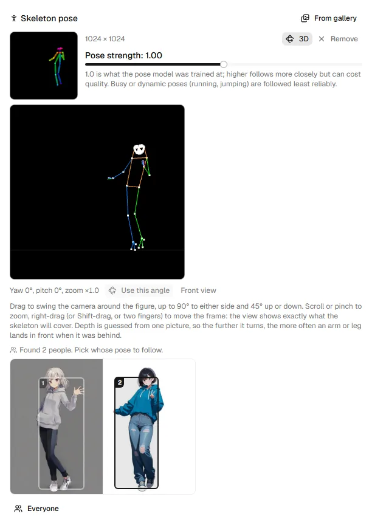
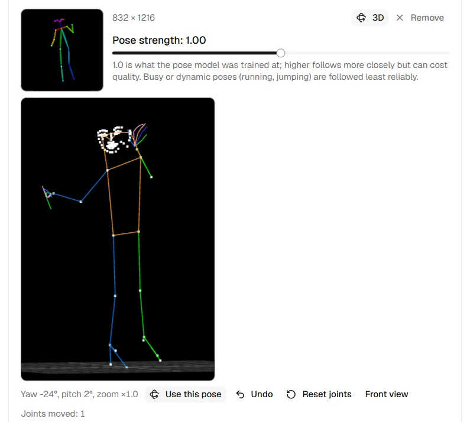

# Pose and the 3D view

**Skeleton pose** makes the run follow a pose taken from any picture, even
a group picture: the backend finds the people in it, you pick which of them
to follow, turn their pose in 3D and frame it if you like, and the run is
drawn along that skeleton. It needs a backend that offers pose control: the
built-in engine (SDXL models and Anima v1.0), a ComfyUI backend while the
engine runs, with a Pose ControlNet or a workflow of your own (see
[Backends](../reference/backends.md#pose)), or a server that implements it
(see the [backend API](../backend-api.md)).

## Take a pose from a picture

Drop a picture on **Skeleton pose**, choose one **From gallery**, use **Use
the source's pose** when a source image is set, or **Use as pose reference**
in the gallery viewer. The skeleton the run will follow appears at once, drawn
for the output's size.

**Pose strength** is how closely it is followed: 1.0 is what the pose model
was trained at; higher follows more closely but can cost quality. Busy or
dynamic poses (running, jumping) are followed least reliably.

## Choose whose pose

{ width="440" }

With several people in the picture, their boxes are drawn over it, numbered
left to right. Click a box to follow that person or leave them out, so two
of three can be used; at least one stays. **Everyone** picks the whole
group. A backend that takes only one person or everyone (one without
`person_subsets`, see the [backend API](../backend-api.md)) offers just
that, and the chooser says why; Latentry's engine takes any set from
poseorbit 0.2.0 (run **Repair / update** on [Setup](engine.md) once). The
run sends only the skeleton, so the people's looks do not carry over.

## Turn it and frame it in 3D

{ width="420" }

Press **3D** to open the 3D view. It has the output's shape and shows exactly
what the skeleton will cover.

| To | Do |
|---|---|
| Swing the camera around the figure | Drag (up to 90° to either side, 45° up or down) |
| Zoom in or out | Scroll, or pinch (×0.5 to ×6) |
| Move the frame | Right-drag, Shift-drag, or drag with two fingers |
| Move a joint | Drag the joint (see below) |

The angle and zoom show under the view. Press **Use this pose** to have the
skeleton drawn from there; **Front view** goes back. The skeleton's
thumbnail then says "Seen from yaw …".

Zooming in turns a full-body reference into an upper-body or face close-up;
zooming out leaves room around the figure.

!!! note "Things to know"
    - Depth is guessed from one picture, so the further it turns, the more
      often an arm or leg lands in front when it was behind.
    - Some models draw a strongly turned figure from behind. Turn away from
      the side the figure already shows, keep the turn moderate, and put
      "front view" in the prompt and "from behind" in the negative.
    - With an SDXL model, the skeleton is body only. In a close-up a warning
      says how few body joints are left in the frame: the model has little
      to follow.
    - If you change the output size after drawing a skeleton, it is fitted
      inside; **Detect again** lines it up.

### Move a joint

Drag the head, a shoulder, elbow, wrist, knee, ankle or a foot point in the
3D view. It turns about the joint it hangs from, and everything below it
comes along: drag an elbow and the forearm and hand follow. No bone changes
length, so a joint swings around rather than stretching.

- The joint moves across the screen. To move it toward or away from you,
  swing the camera to the side and drag it again.
- A hand keeps its shape and moves with its wrist; the face moves with the
  head. Fingers do not move one by one.
- The hips stay where they are. To turn the whole figure, swing the camera.
- Moving a shoulder does not move the head.
- **Undo** takes back the last drag, **Reset joints** all of them. "Joints
  moved: N" shows under the view. Press **Use this pose** to draw the
  skeleton with them.
- The moves stay with the picture: picking other people or another angle
  keeps them, and a new picture starts as detected. They are held only in
  the page, never saved.

Moving joints needs poseorbit 0.3 in Latentry's engine (run **Repair /
update** on [Setup](engine.md) once). On a backend that cannot, the view
says so (see `movable` in the [backend API](../backend-api.md)).

The detection, 3D turn and drawing are
[poseorbit](https://33rd-kk.github.io/poseorbit/), which can also be used on
its own.

## When pose or the 3D view does not show

If a backend cannot use a feature, the form says so in a folded line,
**Not available on this backend: …**. Open it to see why and what would turn
the feature on:

- **The server says: …** comes from the backend itself. The built-in engine
  uses it to say, for example, that an Anima model with 40 layers cannot
  follow a pose and a 28-layer v1.0 one can.
- **/api/health does not say "pose_control": true** means a server you run
  yourself has not announced pose. It needs `pose_control: true` in
  `/api/health`, `POST /api/pose`, and the `pose_*` fields on
  `/api/generate` (see [POST /api/pose](../backend-api.md#post-apipose)).
- An A1111 web UI cannot follow a skeleton through Latentry. Use the built-in
  engine or a diffusers-compatible server.

When the pose works but the **3D** button does not appear, a note under the
skeleton says so. The backend's `/api/pose` needs to take `want_3d` and
`camera` and answer with `limits`, plus `limits.zoom` for zooming (see
[Turning the pose](../backend-api.md#turning-the-pose-optional)).

If you switch to a backend without pose while a skeleton is set, a warning
says the skeleton is left out of the run.
