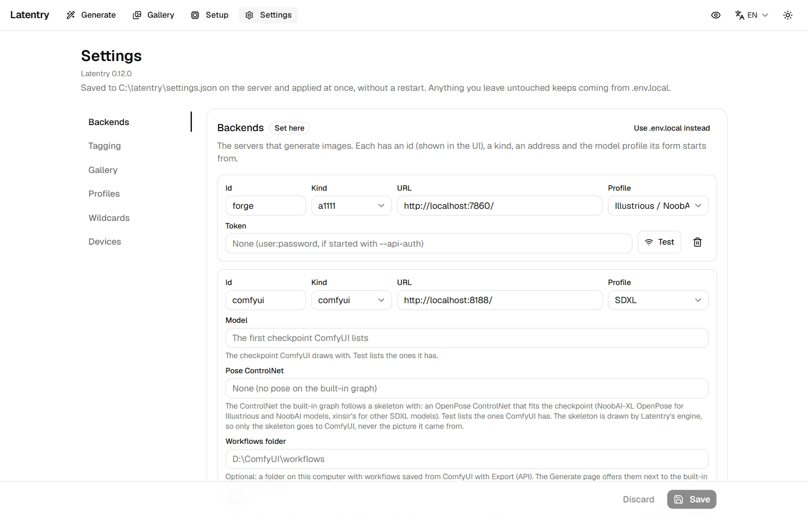

# Settings

Everything here is saved to `latentry.settings.json` on the server and
applies at once, without a restart. What you leave untouched keeps coming
from `.env.local`; a section's badge says which it uses ("Set here" or
"From .env.local"), and **Use .env.local instead** goes back.

The list on the left (above, on a phone) shows one section at a time:
**Backends**, **Tagging**, **Gallery**, **Profiles**, **Wildcards** and
**Devices**. A dot marks a section with unsaved changes, a red one a section
with a field to fix. **Save** at the bottom saves every section at once. A
link can open a section, for example `/settings#gallery`; without one, the
page opens at the section you chose last in this browser.

By default, settings can only be changed on the computer running Latentry
(opened as `http://localhost`); see [Other devices and security](network.md).

## Backends

The servers that generate images. Each has:

- **Id**: what the UI calls it (a–z, 0–9, `-`, `_`).
- **Kind**: `diffusers` (a server speaking the [backend API](../backend-api.md)),
  `a1111` (AUTOMATIC1111 / Forge with `--api`) or `comfyui` (a ComfyUI
  server; see [Backends](../reference/backends.md#comfyui)).
- **URL**: where it listens.
- **Profile**: the model profile its form starts from.
- **Model** (`comfyui` only): the checkpoint ComfyUI draws with. **Test**
  fills the list with the ones it has; left empty, it is the first.
- **Pose ControlNet** (`comfyui` only, optional): the ControlNet the
  built-in graph follows a [skeleton pose](pose.md) with: an OpenPose
  ControlNet that fits the checkpoint (see
  [Backends](../reference/backends.md#pose) for which one). **Test** fills
  the list; left empty, the backend offers no pose.
- **Workflows folder** (`comfyui` only, optional): a folder of workflows
  saved with ComfyUI's **Export (API)**, offered on the Generate page (see
  [Backends](../reference/backends.md#your-own-workflows)). **Show workflow
  names on paired devices** lets paired phones see and use them; it is off
  by default.
- **Token**: a Bearer token for `diffusers` and `comfyui` (for a proxy in
  front of it), `user:password` for `a1111` started with `--api-auth`. Saved tokens are never shown again; type to
  replace one. A token is only sent to the server it was saved for: changing
  the URL to another host, port or scheme asks for the token again. A
  `GEN_TOKEN_<ID>` from `.env.local` likewise applies only while
  `GEN_BACKENDS` lists that id at the same address.

**Test** checks the address and shows the loaded model. Latentry's own engine
is not listed here; it comes from [Setup](engine.md).

## WD14 tagging

What reads tags (tag extraction, gallery tags, bulk tagging): **Tag with**
the built-in model (Latentry runs it on the CPU) or a backend that has a
tagger. The built-in model needs a folder with `model.onnx` and
`selected_tags.csv` from a SmilingWolf WD tagger, which Setup can download.
**General threshold** and **Character threshold** set how sure a tag must be.

## Gallery folders

- **Save folder**: every finished picture is saved here with its settings;
  created if missing. Empty: pictures are not saved (download them one by
  one).
- **Other folders (read-only)**: other tools' output to browse. Latentry
  never writes to these. **Add folder** adds one.
- **Display name**, next to each folder: what the gallery's tabs and other
  devices call it (up to 40 characters). Left empty, the folder gets a
  made-up name such as "Amber Fox" that stays the same.
- **Tag every saved image with WD14 as it arrives.**
- **Write LoRA hashes into saved images** (off by default). A picture made
  with LoRAs on Latentry's engine then carries A1111's "Lora hashes", which
  sites such as Civitai use to link the LoRAs. A hash identifies the exact
  file on this computer, so anyone you share the picture with can tell which
  files you have. Off, the picture still names the LoRAs and their weights.

The browser never sees these paths or the folders' own names; it only
knows folders by number and display name.

## Model profile defaults

What a form starts from for each model family: width, height, steps, CFG,
negative prompt, quality tags and artist notation (`{artist}` stands for the
name, for example `by {artist}`; `-` hides the artist field). Empty boxes use
the built-in value shown in grey. Changes apply to new forms, a profile switch
and a form reset.

**Tag spelling** and **Never respell** take effect on the next generation:

- **Tag spelling** is how the family writes the words in a tag: underscores
  (`long_hair`; built in for SDXL, Illustrious / NoobAI and Pony), spaces
  (`long hair`; Anima) or as typed (generic).
- **Never respell** lists the tags that are always left exactly as written,
  comma-separated. `*` matches anything, so `score_*` (the built-in value)
  covers `score_9` and `score_8_up`. `-` keeps nothing.

**Save** keeps the changes; **Discard** drops them.

## Wildcards

**Wildcards folder** is an existing folder of `.txt` files, one choice per
line, for `__name__` in a prompt (see [Generate](generate.md#prompts)).
Subfolders work as `__folder/name__`, up to 3 deep. Lines starting with `#`
and blank lines are skipped, and a file over 1 MB is not read. Latentry only
reads the folder. Leave it empty for no wildcards.

**Use on paired devices** is off by default. While it is off, the picker and
wildcards are on this computer only. On, paired phones and computers can
list the wildcards' names and use them, so they see your file names and the
lines that end up in their prompts.

## Phones and other computers

The pairing card: whether Latentry listens on this computer only or is open
to your network, **Add a device** for a one-time code, the paired devices
with **Remove**, and **Forget all devices**. See
[Other devices and security](network.md#use-it-from-a-phone-or-another-computer).
