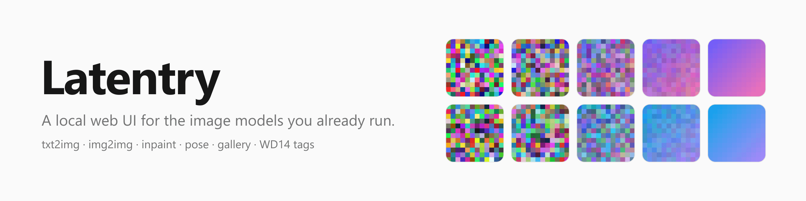
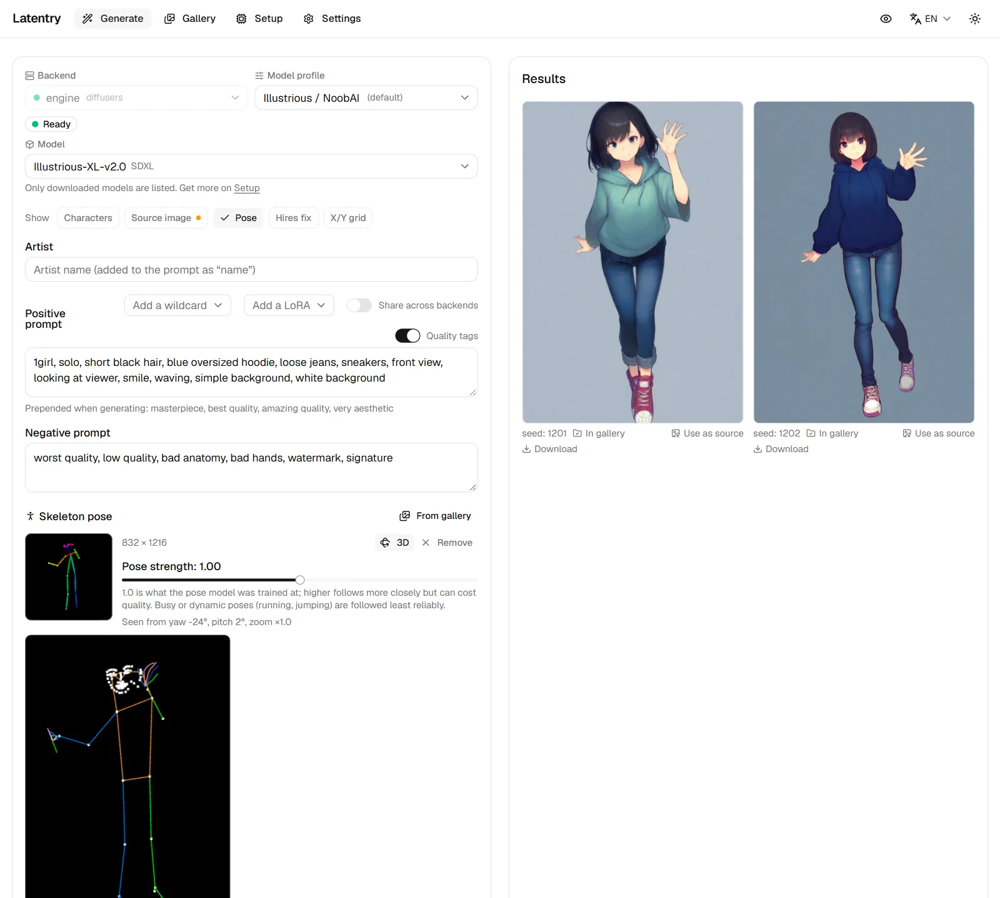

# Latentry

<picture>
  <source media="(prefers-color-scheme: dark)" srcset="assets/banner-dark.png">
  
</picture>

**Private, local image generation. Every picture remembered.** A web UI
on your own computer, in front of Latentry's own engine, the servers you
already run, or both. Your prompts, pictures and settings stay on your
machine. Every picture is saved with how it was made, and the gallery finds
it again by what it shows or how it was made.

## What it does

- **Generate**: text-to-image, img2img (a variation, or a picture as a pose
  reference) and inpainting with a painted mask. [Hires fix](guide/generate.md#hires-fix)
  redraws a new picture at a larger size, and
  [Upscale](guide/generate.md#upscale-a-picture) does the same to one already
  in the gallery. [Extend](guide/generate.md#extend-a-picture-outpainting)
  grows a picture's canvas and draws the new area, and
  [wildcards](guide/settings.md#wildcards) fill in parts of a prompt from a
  folder of text files. More runs [queue](guide/generate.md#the-queue)
  behind the one going, and an [X/Y grid](guide/generate.md#xy-grid) draws a
  run again for each value of one or two settings.
- **Poses from group pictures, turned in 3D**: pick which of the people in a
  picture to follow (one, several or everyone), turn the pose in 3D and frame
  it, then generate along that skeleton. See
  [Pose and the 3D view](guide/pose.md).
- **Several backends and model families**: each backend keeps its own form,
  and a model profile (Anima, SDXL, Illustrious / NoobAI, Pony, generic) sets
  sizes, steps, CFG, negative prompt, artist notation and quality tags.
- **Gallery**: every finished image is saved with its settings embedded
  (readable by A1111's PNG Info too); other tools' folders are browsed
  read-only, with settings read from PNG, JPEG and WebP. Search by prompt,
  tag or setting (`model:`, `steps:>=30`), order and filter, stack pictures
  that share a prompt, compare two, and send settings, tags or the picture
  back to the form.
- **Private by design**: nothing is sent anywhere you did not set up, no
  telemetry, settings only from this computer, and a secret mode. See
  [Privacy](guide/privacy.md).
- **Tags**: WD14 tags from a source picture, carried into the prompt by group
  (hair, eyes, outfit…); tags under every gallery card; tag a whole selection
  at once.
- **Built-in engine**: Latentry installs and runs stock diffusers on your
  NVIDIA GPU from its Setup page, and downloads models only after showing
  their licence.

## Where to start

1. [Getting started](getting-started.md): install, set up the engine,
   generate the first picture.
2. The guide, page by page: [Generate](guide/generate.md),
   [Pose and the 3D view](guide/pose.md), [Gallery](guide/gallery.md),
   [Privacy](guide/privacy.md),
   [Setup and the engine](guide/engine.md), [Settings](guide/settings.md).
3. [Other devices and security](guide/network.md) before using it from a
   phone.

Latentry is open source (MIT):
[github.com/33rd-kk/latentry](https://github.com/33rd-kk/latentry). Its pose
detection is [poseorbit](https://33rd-kk.github.io/poseorbit/).
